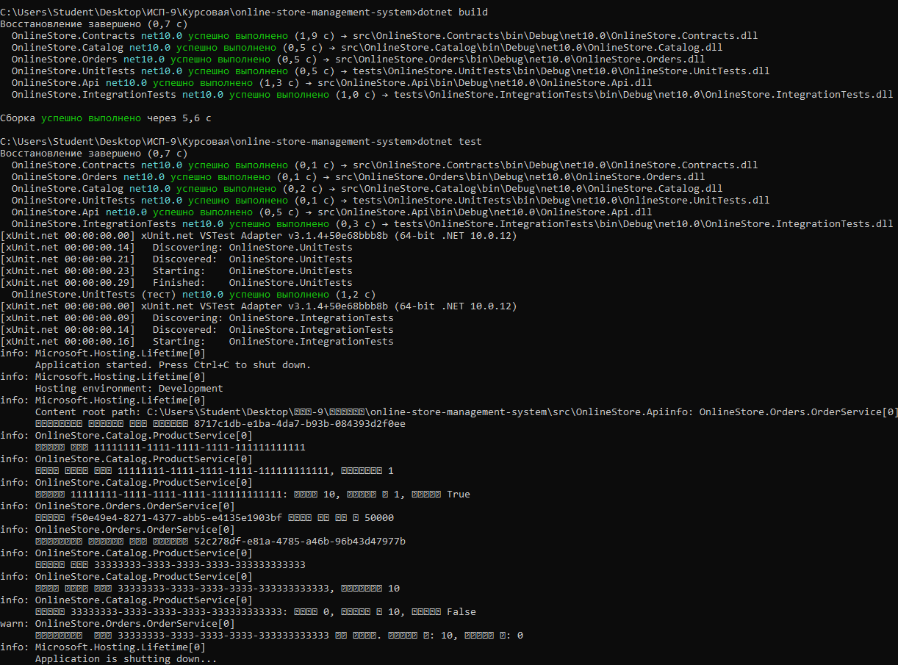
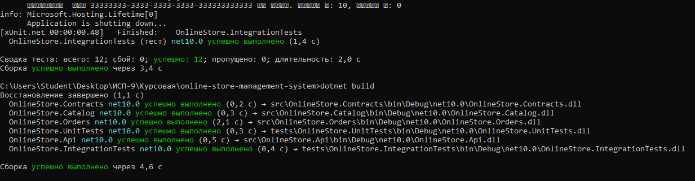

# Курсовое проектирование. Этап 5. Инспекция кода модулей проекта

**МДК:** 02.02 «Инструментальные средства разработки программного обеспечения»  
**Продолжительность:** 4 часа  
**Основной стек:** C# / .NET 9, Git  
**Форма:** этап курсового проектирования  
**Тема курсового проекта:** «Разработка системы управления интернет-магазином»

---

## 1. Цель

Получить проверяемый результат по теме «Инспекция кода модулей проекта», связанный с собственным курсовым проектом студента, и оформить его в репозитории так, чтобы решение можно было воспроизвести и проверить.

---

## 2. Исходное состояние проекта

Работа велась в ветке:

```bash
refactor/etap5-code-review
```

Перед началом выполнения этапа проект содержал работающие модули `CatalogModule` и `OrderModule` с пройденными тестами (Этап 3) и исправленными дефектами (Этап 4).

Исходное состояние было проверено командой:

```bash
git status
git log --oneline -1
```

## 3. Выполненные действия
### 3.1. Инструментальная проверка
Проверка форматирования:

```bash
dotnet format --verify-no-changes
```
Результат: нарушения форматирования не обнаружены.

Сборка проекта:

```bash
dotnet build
```

Результат: сборка успешна, предупреждений компилятора: 0.

Запуск тестов:

```bash
dotnet test
```
Результат: все тесты проходят (6 модульных + 2 интеграционных).
### 3.2. Ручная инспекция кода
Проведена инспекция по чек-листу из задания:
- Понятность имён - сделано
- Ответственность классов и методов- сделано
- Направление зависимостей - сделано
- Дублирование логики - сделано
- Обработка null — найдены проблемы
- Валидация входных данных — найдены проблемы
- Обработка исключений - сделано
- Использование CancellationToken — найдены проблемы
- Работа с конфигурацией и секретами - сделано
- Корректность внешних контрактов - сделано
- Наличие тестов - сделано
- Отсутствие мертвого и закоммен - сделано
- Предупреждения компилятора - сделано

### 3.3. Найденные проблемы
В ходе инспекции выявлено 8 замечаний.

Критичные проблемы (исправлены):

- Отсутствие валидации входных данных в OrderService.CreateOrderAsync
- CancellationToken не передаётся в асинхронные вызовы
- Непонятное имя переменной _orders

Некритичные проблемы (отложены):

- Захардкоженные данные в конструкторе ProductService
- Отсутствие глобального обработчика исключений в API
- Возврат null вместо исключений при отсутствии товара

### 3.4. Исправления
#### Исправление 1: Валидация входных данных

В файл src/OnlineStore.Orders/OrderService.cs добавлены проверки:

```csharp
if (request == null)
{
    _logger.LogError("Запрос на создание заказа не может быть null");
    return null;
}

if (request.Items == null || request.Items.Count == 0)
{
    _logger.LogWarning("Заказ должен содержать хотя бы один товар");
    return null;
}

if (request.CustomerId == Guid.Empty)
{
    _logger.LogWarning("Невалидный ID клиента: {CustomerId}", request.CustomerId);
    return null;
}
```

#### Исправление 2: Передача CancellationToken
В том же файле обновлены вызовы методов:

```csharp
var product = await _productService.GetProductAsync(item.ProductId, cancellationToken);
// ...
var hasStock = await _productService.CheckStockAsync(item.ProductId, item.Quantity, cancellationToken);
```

####Исправление 3: Переименование переменной
Заменено:

```csharp
private readonly List<Order> _orders = new();
```
на 
```csharp
// Хранилище заказов в памяти
private readonly List<Order> _inMemoryOrders = new();
```

### 3.5. Финальная проверка
После исправлений выполнены команды:

```bash
dotnet build
dotnet test
```

Результат: сборка успешна, все тесты проходят.



Скриншот 3.2 — Результаты финальной проверки

## 4. Таблица замечаний

## 4. Таблица замечаний

| № | Место | Проблема | Риск | Рекомендация | Статус |
|---|---|---|---|---|---|
| 1 | `OrderService.CreateOrderAsync` | Отсутствие проверки `request` на `null` | `NullReferenceException` при передаче `null` | Добавить проверку на `null` в начале метода |  Исправлено |
| 2 | `OrderService.CreateOrderAsync` | Отсутствие проверки `request.Items` на пустоту | Создание заказа без товаров | Добавить проверку `Items.Count > 0` |  Исправлено |
| 3 | `OrderService.CreateOrderAsync` | `CancellationToken` не передаётся в вызовы `GetProductAsync` и `CheckStockAsync` | Невозможность отмены длительной операции | Передать `cancellationToken` во все асинхронные вызовы |  Исправлено |
| 4 | `OrderService` | Переменная `_orders` имеет неясное назначение | Путаница при масштабировании проекта | Переименовать в `_inMemoryOrders` и добавить комментарий |  Исправлено |
| 5 | `ProductService` конструктор | Список товаров захардкожен в конструкторе | Сложно тестировать и изменять данные | Вынести данные в конфигурацию или метод инициализации |  Отложено (учебный проект) |
| 6 | `Program.cs` | Отсутствие глобального обработчика исключений | Необработанные исключения возвращают 500 без деталей | Добавить middleware для обработки исключений |  Отложено (не критично) |
| 7 | `OrderService.CreateOrderAsync` | Отсутствие валидации `CustomerId` на `Guid.Empty` | Создание заказа с невалидным ID клиента | Добавить проверку `request.CustomerId != Guid.Empty` |  Исправлено |
| 8 | `ProductService.GetProductAsync` | Возврат `null` вместо выброса исключения при отсутствии товара | Сложнее отследить ошибку в вызывающем коде | Рассмотреть возврат `Result<ProductDto>` или выброс `NotFoundException` | ️ Отложено (текущий подход принят) |

## 5. Вывод
В рамках пятого этапа курсового проектирования проведена формализованная инспекция кода модулей проекта «Разработка системы управления интернет-магазином».

В ходе инспекции выявлено 8 замечаний, из которых 4 критичных исправлены:
- Добавлена валидация входных данных в `OrderService.CreateOrderAsync`
- Исправлена передача `CancellationToken` в асинхронные вызовы
- Переименована переменная `_orders` в `_inMemoryOrders` для ясности

Остальные 4 замечания отложены как некритичные для учебного проекта, но задокументированы в таблице замечаний.

После исправлений выполнены инструментальные проверки (`dotnet format`, `dotnet build`, `dotnet test`) — все проверки пройдены успешно.

Проведённая инспекция демонстрирует навык систематического анализа кода по формализованному чек-листу и способность выявлять и устранять проблемы качества кода.